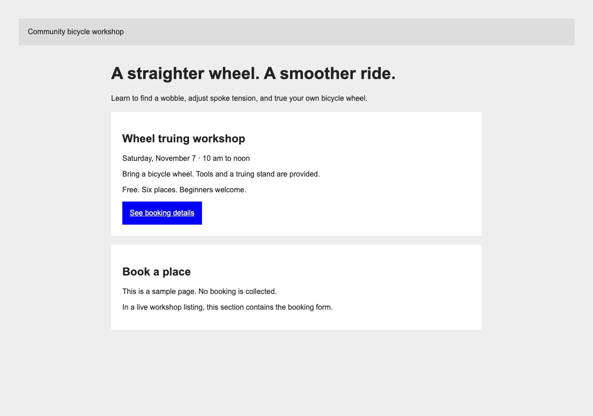
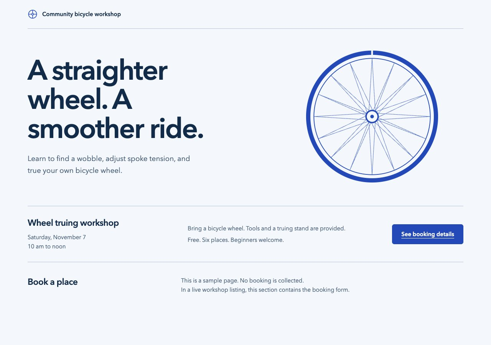
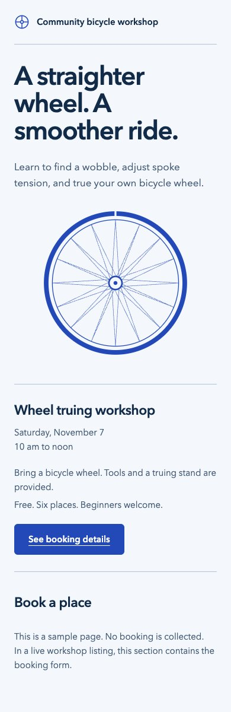

# Sample run

Swag was applied in this session to the [before page](before.html) to produce the [after page](after.html). The page is an illustrative bicycle workshop listing. Its booking link points to an explanatory section and collects no bookings.

The brief keeps the workshop content and booking link, gives the page a workshop identity, and adds easing and weight to its interactions. This is an in-session execution of the skill's instructions, not an independent evaluation of skill discovery. Critique assessments ran sequentially because delegation was prohibited. Their reduced independence limits the review.

## Direction and palette

Frontend-design set a practical workshop direction with a wheel diagram, generous type, and a clear event row. The typography uses Avenir Next where installed, with local sans-serif fallbacks. No font download is required.

The palette suggestions were an established [Radix blue and slate system](https://www.radix-ui.com/colors/docs/palette-composition/understanding-the-scale), the incumbent blue and gray, or a custom workshop blue. The custom palette was selected for this sample to keep the bicycle drawing and booking action in one blue while giving the text a darker ink. These are its semantic colors:

| Role | Color |
|---|---|
| Page | `#f4f7fc` |
| Primary text | `#122b49` |
| Secondary text | `#445b76` |
| Action and diagram | `#2349b8` |
| Separator | `#b2c1d7` |
| Booking highlight | `#e4ecfb` |

## Critique and polish

Impeccable's context launcher ran against the sample. Its critique and polish references informed two priorities: give the generic page a subject-specific hierarchy, and add a skip link and explicit focus treatment. The result keeps the factual copy, labels the page regions, and groups the workshop details around the booking action. Questions were skipped because the brief settled the choices and the critique identified two priority issues.

The final detector scan returned one `cramped-padding` warning for the hero's top edge. Browser inspection measured `padding-top: 44px`; the static detector misses the `padding-block` declaration. The warning is recorded as a false positive, not a clean detector pass. No live detector overlay or independent assessment was used.

## Motion

Animate's button recipe and motion guidance informed an original implementation. Swag's preference for eased feedback governs the frequency decision. The wheel gets a single 600ms settle on entry. Hover and press use 160ms transitions with the sourced curve `cubic-bezier(0.23, 1, 0.32, 1)`. A press stretches width to 1.02 and compresses height to 0.96, then settles on release. The booking highlight fades over 200ms.

The reduced-motion variant uses a 160ms opacity entrance, removes hover and press transforms, and uses immediate anchor scrolling. Focus remains usable throughout. The small action background also eases between colors; this is an intentional exception to the general preference for transform and opacity. The page needs no animation library.

## Verification

The current web guidelines were fetched from their [official source](https://github.com/vercel-labs/web-interface-guidelines/blob/main/command.md) on October 22, 2026. The review covered the after page's applicable semantics, navigation, focus, motion, type, content, layout, and performance rules. Sentence case follows the project's prose convention as an intentional exception to the guidelines' title-case preference.

- Browser checks found no horizontal overflow at widths of 390, 768, 1280, and 1600 pixels. No script errors occurred during these loads.
- Tab reached the skip link with a solid focus outline. Tab and Enter activated the booking link and set the URL fragment to `#booking`.
- A held press produced a computed transform of approximately `scale(1.02, 0.96)`. Releasing and moving away restored the resting transform.
- Reduced-motion emulation produced opacity-only entrance keyframes, no press transform transition, and immediate anchor scrolling.
- Calculated contrast is 13.33:1 for primary text on the page, 6.51:1 for secondary text, 7.73:1 for the white action label, and 5.89:1 for secondary text on the booking highlight.
- The screenshots were opened and inspected. This run does not establish cross-browser or screen-reader compatibility, or the subjective feel of motion on physical devices.

## Screenshots

Both desktop captures use a 1280 by 900 viewport, the top of the page, and settled motion. The mobile capture uses 390 by 1200.

Before:



After:



Mobile:



## Run locally

From the repository root:

```sh
python3 -m http.server 8765 --bind 127.0.0.1 --directory skills/swag/examples
```

Open [the before page](http://127.0.0.1:8765/before.html) and [the after page](http://127.0.0.1:8765/after.html). The sample works offline after it is served. Press the booking action to see its compression and highlight; enable reduced motion to compare the gentler treatment.
